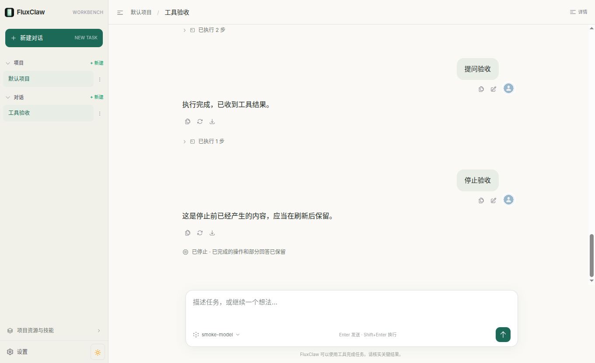

# FluxClaw

**A general-purpose LLM Agent Workbench for research, coding, and document creation.**

FluxClaw combines **Phoenix LiveView**, **BEAM / Erlang OTP**, and **Electron** to bring projects, conversations, tools, memory, and deliverables into one workspace. Use it in a browser or as a desktop application with its own local backend.



## Features

- **Project workspaces** — Organize conversations, reusable skills, memory documents, and working checkpoints by project.
- **Streaming conversations** — Connect to an OpenAI-compatible Chat Completions endpoint with SSE streaming. Read earlier content without being pulled to the bottom, and jump back to the latest response when ready.
- **Visible tool execution** — Inspect grouped activity, parameters, results, and failures. Persistent call IDs distinguish repeated calls to the same tool, including after a refresh.
- **Human interaction** — Answer agent questions in dedicated cards, review proposed file changes, and preview skill suggestions before saving them.
- **Files and deliverables** — Upload attachments and browse, preview, or download real files from the current session workspace.
- **Native integrations** — Call SciPhi AgentSearch and the bundled Google Harness² implementation directly through the existing LLM tool interface.
- **Reliable task controls** — Restore conversation drafts within the same window, use IME-safe keyboard input, and stop execution while retaining partial answers and completed tool results.
- **Responsive interface** — Warm light and charcoal dark themes, collapsible navigation, optional details, and mobile drawers.
- **Desktop runtime** — Electron bundles a Phoenix release, ERTS, and Python, with local data storage and an authenticated loopback backend.
- **Plugin support** — Extend tools through the DeepSeek Harness / Cordis bridge, including npm plugins and local `.mjs` plugins.

## Quick Start

### Prerequisites

- Elixir and Erlang/OTP compatible with the project dependencies. The desktop build workflow uses **Elixir 1.18 / OTP 27**.
- **Node.js 22+** and npm for asset setup, the plugin bridge, and Electron development.
- Native build tools required by dependencies such as the SQLite adapter. No separate database server is required.
- An OpenAI-compatible model endpoint and credentials for live agent tasks.
- **Python 3.12 or 3.13** if you want to use Harness² from the web application. Desktop packages include Python.

### Run the Web Application

```bash
git clone https://github.com/MobtgZhang/FluxClaw.git
cd FluxClaw
mix setup
```

Copy the example configuration:

```bash
cp .fluxclaw/config.example.json .fluxclaw/config.json
```

Set your model credentials in `.fluxclaw/config.json`, or use environment variables:

```bash
export OPENAI_API_KEY="your-api-key"
export OPENAI_BASE_URL="https://api.openai.com/v1"
export OPENAI_MODEL="your-model-name"
mix phx.server
```

Open [http://localhost:4000](http://localhost:4000), choose a project, and start a conversation. Model settings can also be edited in the application.

## Configuration

A minimal configuration looks like this:

```json
{
  "openai": {
    "api_key": "your-api-key",
    "base_url": "https://api.openai.com/v1",
    "model": "your-model-name"
  },
  "sandbox_root": "./flux_claw_sandbox",
  "agents": {
    "max_steps": 32
  },
  "integrations": {
    "search_url": "",
    "search_mode": "local",
    "search_key": "",
    "python": ""
  }
}
```

By default, FluxClaw reads `.fluxclaw/config.json` and merges overrides from `fluxclaw/cache/config.json`. Settings saved in the application go to the latter file. Set `FLUXCLAW_CONFIG_PATH` to use one explicit file for both reading and writing; `FLUX_CLAW_CONFIG_PATH` is also supported.

Environment variables take precedence over the corresponding file settings:

- **Model:** `OPENAI_API_KEY`, `OPENAI_BASE_URL`, `OPENAI_MODEL`.
- **Execution:** `FLUX_CLAW_SANDBOX`, `FLUXCLAW_MAX_STEPS`. A step limit of `-1` allows unlimited agent rounds.
- **Storage:** `FLUXCLAW_CACHE_ROOT`, `FLUXCLAW_CACHE_EXTERNAL_SKILLS`, `FLUXCLAW_CACHE_INTERNAL_SKILLS`, `FLUXCLAW_CACHE_HISTORY`, `FLUXCLAW_CACHE_MEMORY`.
- **Integrations:** `AGENT_SEARCH_URL`, `AGENT_SEARCH_MODE`, `AGENT_SEARCH_API_KEY`, `FLUXCLAW_PYTHON`.

The [example configuration](.fluxclaw/config.example.json) includes additional sampling and storage options. Set environment variables before starting the application.

## Native LLM Tools

Built-in tools cover file reading and editing, patch application, shell commands, web fetching, task planning, user questions, working checkpoints, and durable memory. Their schemas and dispatch are defined in [the tool registry](lib/flux_claw/tool.ex).

### AgentSearch

The native `agent_search` tool connects to [SciPhi-AI/agent-search](https://github.com/SciPhi-AI/agent-search) and returns numbered citations, source URLs, titles, and bounded excerpts.

Configure it in the details panel or before starting FluxClaw:

```bash
export AGENT_SEARCH_URL="http://127.0.0.1:8000"
export AGENT_SEARCH_MODE="local"
# Optional, when required by your service:
export AGENT_SEARCH_API_KEY="your-search-key"
```

`local` uses the upstream hierarchical `/search` contract. `sciphi` supports the historical hosted API contract. The model supplies the query and result limit; the server owns the endpoint and credentials.

**A deployed AgentSearch service with a populated index is required.** FluxClaw does not bundle the search databases, embedding models, or datasets. Availability of the historical hosted API has not been verified. The upstream self-hosted stack requires Python below 3.12 and should run separately from Harness².

### Harness²

The native `harness2_optimize` tool uses a pinned copy of [google-research/harness2](https://github.com/google-research/harness2) with a FluxClaw text-task adapter. It generates candidates, refines Markdown prompt components, selects a deliverable, and saves reusable experience through the currently configured model.

- `operation: "optimize"` accepts a text task and produces an answer, report, and execution evidence.
- `operation: "demo"` runs the upstream deterministic ledger tasks without model credentials.
- `mode` supports `parallel` or `sequential`; `k` supports `1` or `2`.
- Each run is limited to 30 model calls and 300 seconds. Optimization can incur multiple model requests and associated costs.

For web development, select a compatible interpreter:

```bash
export FLUXCLAW_PYTHON="/absolute/path/to/python3.12"
```

The bundled core requires no third-party Python packages. Outputs live under the session workspace in `harness2/<run-id>/`, with reusable experience under `harness2/library/`.

This integration optimizes text deliverables and prompt components. It does not execute model-generated code or provision the upstream benchmark environments. See the [upstream integration notes](docs/upstream-integrations.md) for the pinned revision, API contracts, and implementation scope.

## Electron Desktop

Linux builds produce an **AppImage** and a **deb** package under `desktop/dist/`. The packaged application includes Phoenix, ERTS, and Python, so end users do not need to install Elixir or Python separately. The first launch migrates the local database.

To open a development window, first run `mix phx.server`, then use another terminal:

```bash
npm ci --prefix desktop
npm run dev --prefix desktop
```

To build a distributable on the target operating system, complete `mix setup` and provide a standalone Python distribution matching that OS and architecture:

```bash
npm ci --prefix desktop
export FLUXCLAW_PYTHON_BUNDLE="/absolute/path/to/standalone-python-root"
npm run dist --prefix desktop
```

On Unix, the Python root must contain `bin/python3`; on Windows, it must contain `python.exe`. A virtual environment containing links to an external interpreter is insufficient.

The [desktop workflow](.github/workflows/desktop.yml) provides native Linux, macOS, and Windows build jobs. **Linux x64 packaging and launch have been verified.** macOS and Windows configurations have not been tested on their target hosts. Code signing, macOS notarization, and automatic updates are not configured.

Desktop data is stored in Electron's `userData` directory. Use the application's File menu to open that directory, or set `FLUXCLAW_DESKTOP_DATA` to an explicit location. See the [desktop guide](docs/desktop.md) for installation, logs, storage, and release details.

## Plugins

To enable the DeepSeek Harness / Cordis integration, copy `.fluxclaw/cordis.example.yml` to `.fluxclaw/cordis.yml`, or point `FLUXCLAW_CORDIS_CONFIG` to your configuration file. See the [plugin guide](docs/plugins.md) for supported packages and local plugins.

## Execution and Data Boundaries

Session file tools reject path traversal and symbolic links, and artifact delivery applies file-count, depth, preview, and download limits. Uploads accept up to five files per batch, each up to 8 MB.

**Session directories provide path isolation, not an operating-system sandbox.** Shell commands run with the backend user's permissions. Use a separate isolated environment for untrusted tasks. Stopping a task does not undo file writes or external actions that have already completed.

The desktop backend binds to a random loopback port and requires a per-launch credential. Electron enables renderer sandboxing and context isolation, with Node integration disabled. These renderer controls do not isolate backend shell commands. Model credentials are stored in local configuration files rather than an operating-system keychain.

## Development and Validation

```bash
# Compile with warnings as errors, format, and run tests
mix precommit

# Include the actual Harness² runtime tests
FLUXCLAW_PYTHON=/absolute/path/to/python3.12 mix precommit

# Exercise the text adapter with deterministic model responses
FLUXCLAW_PYTHON=/absolute/path/to/python3.12 python3 test/integrations/harness2_bridge_smoke.py

# Desktop unit tests
npm ci --prefix desktop
npm test --prefix desktop

# Prepare the bundled backend and Python before desktop smoke testing
FLUXCLAW_PYTHON_BUNDLE=/absolute/path/to/standalone-python-root npm run prepare:backend --prefix desktop
npm run test:smoke --prefix desktop
```

The desktop smoke test uses temporary data and a local model fixture to exercise streaming, drafts, IME input, tool execution, clipboard access, attachments, user questions, cancellation, and responsive navigation. These tests do not establish paid-model quality or external search-service availability.

The [acceptance report](reports/validation.md) records the verified commands and limits: 55 backend tests with Harness² enabled, four desktop unit tests, and full workflow checks against the Linux unpacked application and AppImage.

Makefile shortcuts are also available: `make setup`, `make serve`, `make test`, and `make precommit`.

## Documentation

- [Workbench workflows and native integrations](docs/workbench.md)
- [Electron installation and packaging](docs/desktop.md)
- [Upstream integration research](docs/upstream-integrations.md)
- [Architecture](docs/architecture.md)
- [Agents and memory](docs/agent-and-memory.md)
- [Tools and execution boundaries](docs/tools-and-safety.md)
- [Plugins](docs/plugins.md)
- [Acceptance results and interface captures](reports/validation.md)

The detailed guides currently contain Chinese-language documentation. This README provides the English entry point.

## License

FluxClaw is licensed under [Apache-2.0](LICENSE). The vendored Harness² source retains its [upstream license](priv/integrations/harness2_vendor/LICENSE) and [revision notice](priv/integrations/harness2_vendor/UPSTREAM.md). Third-party dependencies, models, datasets, and services remain subject to their own licenses and terms.
