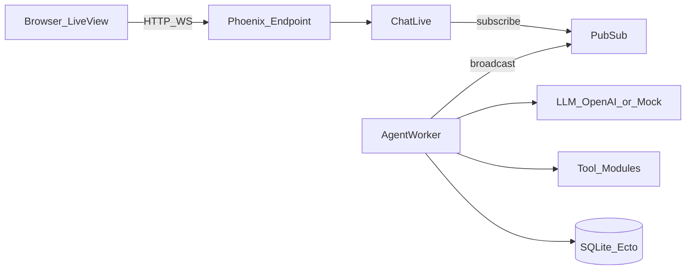

# FluxClaw 架构

## 总览

FluxClaw 是基于 **Phoenix LiveView** 的对话式智能体前端，后端在 **BEAM (OTP)** 上为每个会话运行独立的 `AgentWorker`（GenServer），通过 **Phoenix.PubSub** 将 LLM 流式片段、工具调用与记忆事件推送到浏览器。

## OTP 与会话隔离

- **Registry**：`FluxClaw.Agents.Registry`，键为会话 UUID，唯一对应一个 Worker。
- **DynamicSupervisor**：`FluxClaw.Agents.AgentSupervisor`，按需启动/停止 Worker。
- **沙箱目录**：`Application.get_env(:flux_claw, :agents)[:sandbox_root]` 下按 `session_id` 分子目录，文件类工具仅能访问该路径内文件（经 `FluxClaw.Tools.Sandbox` 解析）。

## 路由与 LiveView

- `/`、`/chat`、`/chat/:id`、`/p/:project_id` 均由同一 `ChatLive` 处理，通过 `handle_params/3` 区分「首页/项目/会话」视图。
- 打开具体会话时订阅 `agent:<session_id>` 主题，并 `Orchestrator.ensure_worker/1` 保证 Worker 已启动。

## 数据层

- **projects**：项目容器。
- **agent_sessions**：对话会话，归属某一 `project_id`。
- **agent_messages**：持久化用户/助手消息文本。
- **skills**：L3 技能条目，可关联 `project_id` 与 `session_id`，`source` 区分结晶/外部等。
- **checkpoints**：会话级工作检查点。

详见 [agent-and-memory.md](agent-and-memory.md)。
