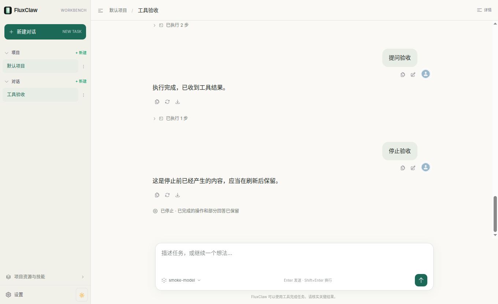
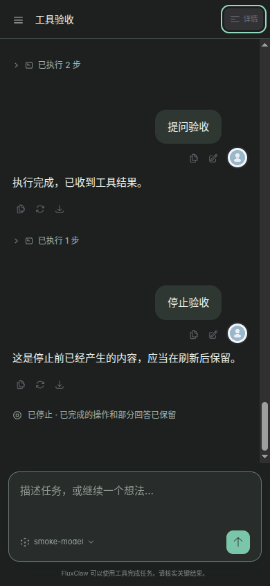

# FluxClaw Agent Workbench

## 使用流程

左侧选择项目或新建任务，输入目标后开始对话。顶栏显示项目 / 会话；详情默认关闭，包含项目技能与 Memory、运行轨迹、工具集成和文件。正文宽度约 760px，导航 248px，详情 320px；390px 视口下使用抽屉。浅深主题都使用暖白、炭灰和青绿色。

助手正文直接排版；每轮工具活动汇总为一个可展开区域，调用按真实 ID 配对，显示运行、完成或失败。先查看结果摘要，再展开参数、完整输出和复制。推理入口仅显示模型确实返回的 reasoning 字段。

Enter 发送，Shift+Enter 换行，中文输入法选词期间 Enter 不会发送。草稿按项目 / 会话保存在当前窗口的 sessionStorage，刷新可恢复。模型接受消息后清空对应草稿。向上阅读时流式回答不抢滚动，可点击“回到最新”恢复跟随。

Agent 询问用户时，对话里出现独立问答卡，提交后继续执行，普通聊天草稿保留。技能建议提供预览、保存和忽略。停止按钮取消当前 worker 及其活动任务，保存已展示的部分正文，并记录未完成调用的停止结果；已经写入的文件或外部操作不会撤销。

## 原生 AgentSearch

在“详情 → 工具集成”设置服务地址、模式和可选密钥。也可以配置：

```json
{
  "integrations": {
    "search_url": "http://127.0.0.1:8000",
    "search_mode": "local",
    "search_key": "",
    "python": "/absolute/path/to/python3.12"
  }
}
```

环境变量 `AGENT_SEARCH_URL`、`AGENT_SEARCH_MODE`、`AGENT_SEARCH_API_KEY` 优先于文件。设置页留空密钥表示保留已有值；环境变量需要在启动进程之前设置。

`agent_search(query, limit)` 已注册为 LLM 内置工具，结果包含 `[1]` 等引用、标题、URL 和受限文本。`local` 使用原仓库 `POST /search` 的分层检索参数，`sciphi` 使用 `provider: agent-search` 和顶层数组响应。服务地址与密钥由服务器配置，模型只能提交查询与 1–10 条结果数。

**需要自行提供已部署且有数据的 AgentSearch 服务。** 本仓库不附带 Qdrant / PostgreSQL 索引、embedding 模型或网页数据，也未验证历史 SciPhi 托管服务如今是否仍接受请求。上游搜索栈要求 Python <3.12，与 Harness² 的 Python 3.12/3.13 应分开部署。未配置或不可用会返回明确错误。固定版本、API 契约和部署数据要求见 [上游调查](upstream-integrations.md)。

## 原生 Harness²

`harness2_optimize` 直接调用 `priv/integrations/harness2_vendor` 中固定的 Google 上游核心，版本 `6868817518876de8fd170c6a8354daca273b6191`。这是上游递归、候选选择和经验复用机制，工作台提供文本任务适配器。

- `operation: optimize`：必填 `task`，由当前 FluxClaw 模型生成候选、改进提示、选择答案和保存经验。编辑范围为 Markdown 提示组件，不执行模型生成的代码。
- `operation: demo`：运行上游两个账本任务，无需模型密钥，用于验证真实优化流水线。
- `mode: parallel | sequential`；`k: 1 | 2`，默认 parallel / 1。最多 30 次模型调用，总计限时 300 秒；这会产生多次模型调用费用。

Web 开发环境需要 Python 3.12 或 3.13，可设置 `FLUXCLAW_PYTHON=/absolute/path/python3.12`。核心无第三方 Python 依赖，已内置源码；无需 `pip install harness2`。桌面发行包包含 Python。

每次运行写入会话目录 `harness2/<uuid>/`，包含 `answer.md`、`report.json`、候选执行、选择轨迹与原始证据；同一会话的 `harness2/library/kN` 复用经验。工具返回选中答案和产物路径，在文件面板刷新即可下载。该适配器针对文本交付，不提供上游全部 Codex / OpenCode 执行器和 WorkBuddy / LAB benchmark 环境。

## 附件与文件

先建立会话，在“详情 → 文件”上传附件。每次最多 5 个，每个 8MB；保存后将实际相对路径加入草稿，供模型调用文件工具读取。点击刷新查看会话目录内真实文件，最多 150 项，深度 8 层。预览限制 512KB，下载限制 20MB。HTML 强制下载，不执行；符号链接和越界路径被拒绝。

会话工作目录是路径隔离，**不是操作系统沙箱**。现有 shell 工具仍以当前用户权限执行命令；在受信任的个人工作站使用，运行不可信任务时应自行部署在隔离环境。Electron renderer 的 sandbox 不会隔离后端 shell 命令。

## 验证

```bash
FLUXCLAW_PYTHON=/absolute/path/python3.12 mix precommit
FLUXCLAW_PYTHON=/absolute/path/python3.12 python3 test/integrations/harness2_bridge_smoke.py
npm test --prefix desktop
# 先准备 desktop/resources，再运行完整桌面流程
npm run test:smoke --prefix desktop
```

桌面 smoke 使用本地模型夹具，实际启动 Phoenix release 和 SQLite，验证 SSE、工具执行、上传、问答、停止、草稿、IME 和移动端溢出。它不证明付费模型质量或外部 AgentSearch 服务可用性。

## 已验证的界面




